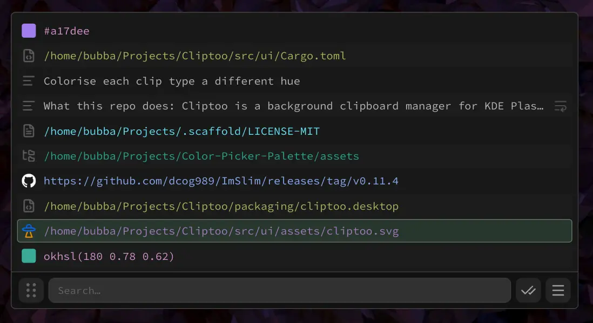
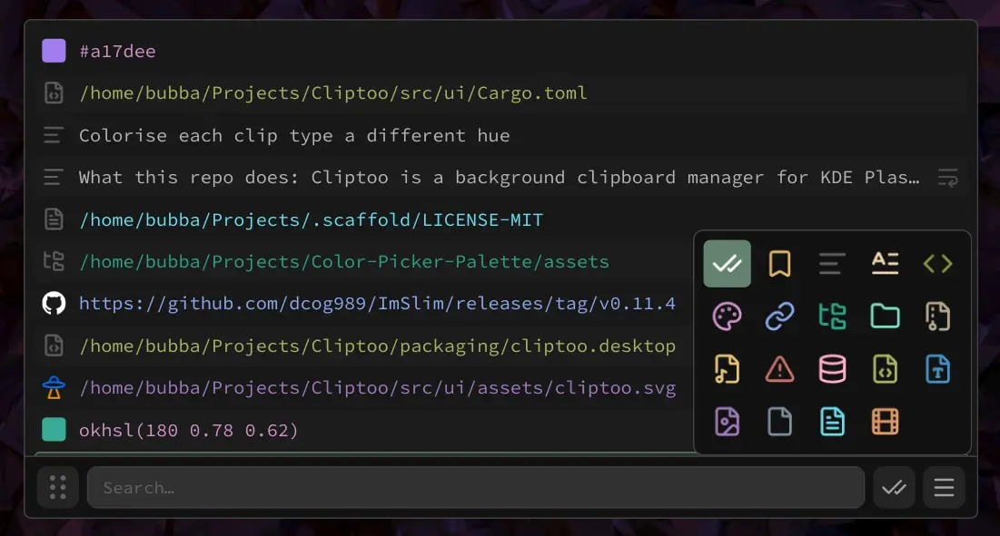
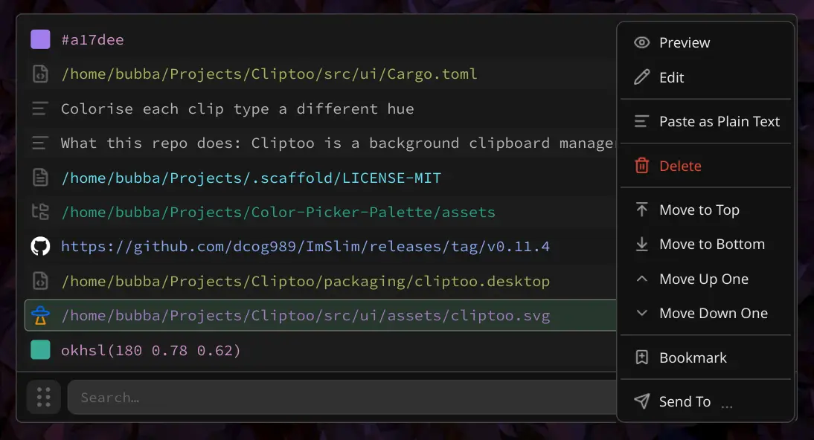
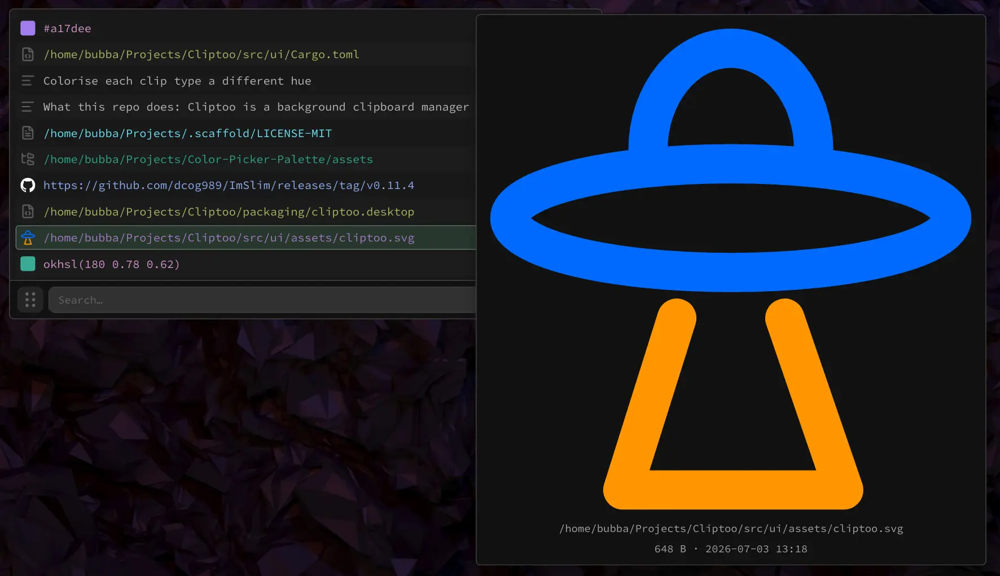
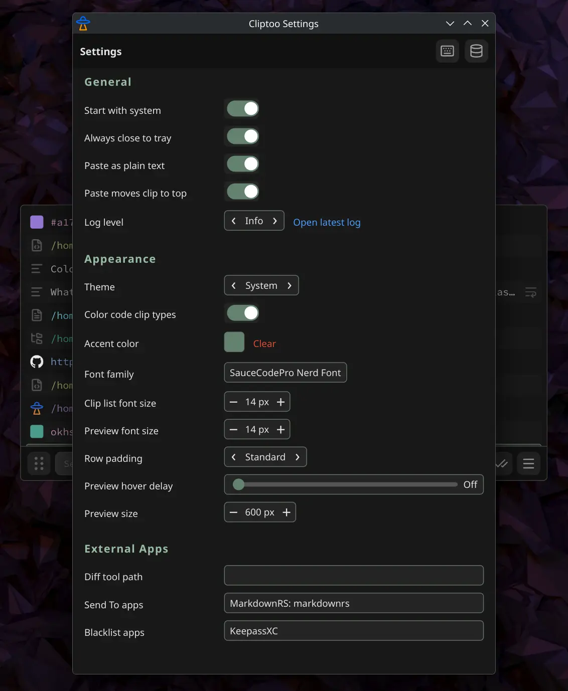

# Cliptoo

 Advanced clipboard manager for Linux KDE. Use your clip history as a library of things. Small footprint, fast performance.

    

## Features

### Performance

- **Persistent History:** SQLite FTS5 search with prefix matching.
- **Fast Search:** Real-time filtering with match highlighting.
- **Virtualized Scrolling:** only visible rows are rendered.
- **Deduplication:** SHA-256 hashing skips repeat copies.

### Clipboard & Paste

- **Capture:** text, rich text, HTML, images, and file paths.
- **Paste:** Enter pastes via an `evdev` virtual keyboard; optional plain-text mode.
- **Global Hotkey:** toggle the window via the XDG `GlobalShortcuts` portal (default `Ctrl+Alt+Q`).
- **Quick Paste:** hold Right Alt and press `1`–`9`.

### Content

- **Filters:** text, links, images, colors, bookmarks.
- **Images:** hover previews for PNG, JPEG, GIF, WebP, AVIF, JXL, SVG, ICO, BMP, and TIFF.
- **QR codes:** right-click an image clip to decode its payload; copy the text or open the URL.
- **Colors:** `#hex`, `rgb()`, `hsl()`, `hwb()`, `lab()`/`lch()`, `oklab()`/`oklch()`/`okhsl()`, with transparency.
- **URLs and Files:** fetched titles and favicons; file size, mtime, and type.
- **Tags:** `##`-prefixed search.
- **Code:** monospace view toggle for code clips.

### Organization & Tools

- **Bookmarks:** exempt from auto-cleanup.
- **Multi-select & Merge:** Ctrl+click, Shift+click, or Ctrl+A selects clips; Delete removes the set after a second press, and Ctrl+M (or right-click → Merge Selected) joins it into one clip.
- **Reordering:** move clips up/down or to the top/bottom.
- **Transforms:** `upper`, `lower`, `camel`, `kebab`, `snake`, `trim`, `timestamp`, and more.
- **Send To / Compare:** open clips in an external app or a diff tool.

### Storage & Maintenance

- **Cleanup:** prune by age and/or count, clear caches, remove dead file clips, reclassify.
- **Backup:** JSON export/import, full history or bookmarks only (copied images are referenced by path, not embedded).
- **Statistics:** DB size, clip count, copy/paste counts.

### Customisation

- Light/Dark/System theme, accent color, fonts, row padding, hover-preview delay and size.

### System Integration

- **Tray and autostart.**
- **App blacklist:** ignore selected applications.

---

## Install

Download [GitHub Latest Release](https://github.com/dcog989/Cliptoo/releases/latest):

| Platform | Format | Install |
|----------|--------|---------|
| Linux | AppImage | `chmod +x cliptoo-*-x86_64.AppImage && ./cliptoo-*-x86_64.AppImage` |
| Debian / Ubuntu | `.deb` | `sudo apt install ./cliptoo_*_amd64.deb` |
| Fedora / RHEL | `.rpm` | `sudo dnf install ./cliptoo-*.x86_64.rpm` |
| Arch / CachyOS | `.pkg.tar.zst` | `sudo pacman -U cliptoo-*.pkg.tar.zst` |
| Arch / CachyOS | `PKGBUILD` (local build) | `make package && sudo pacman -U .pkg/cliptoo-*.pkg.tar.zst` |
| Any | source | `make install` (installs to `/usr/local`) |

> [!NOTE]
> Cliptoo runs on Wayland only (KDE Plasma 6) and requires `xdg-desktop-portal-kde`. Source builds need the [requirements](#requirements); `make uninstall` removes them. The AppImage adds itself to the application menu, installs its icon, and repoints the entry when you move or rename it; Gear Lever and AppImageUpdate can update it in place.

Data lives in `~/.local/share/Cliptoo/` (DB, images), config in `~/.config/Cliptoo/`, cache in `~/.cache/Cliptoo/`, logs in `~/.local/state/Cliptoo/Logs/`.

---

## Development

### Tech Stack

| Component           | Technology                                       |
|---------------------|--------------------------------------------------|
| Language            | Rust (edition 2024)                              |
| UI Framework        | Slint (Qt 6 backend)                             |
| Wayland             | `wl-clipboard-rs`, `wayland-client`, wlr/ext data-control |
| Database            | SQLite + FTS5 (`rusqlite`)                       |
| Async Runtime       | Tokio                                            |
| Image Processing    | `image`, `resvg` (SVG), `jxl-oxide` (JXL), `rqrr` (QR) |
| Colour Science      | `palette` (Oklab / Oklch / Okhsl)                |
| D-Bus / Portals     | `zbus`, `ashpd` (portal hotkeys)                 |
| System Tray         | Slint `SystemTrayIcon`                           |
| Input Emulation     | `evdev` virtual keyboard                         |
| HTTP Client         | `reqwest` (rustls)                               |

### Requirements

- **Rust toolchain** (stable, edition 2024): `curl --proto '=https' --tlsv1.2 -sSf https://sh.rustup.rs | sh`
- **Qt 6, Wayland, dav1d, and fontconfig dev headers, plus the `clang` and `mold` linkers**
  (CI installs them and selects them with `CARGO_TARGET_*` env vars; for local
  builds put `linker = "clang"` and `rustflags = ["-C", "link-arg=-fuse-ld=mold"]`
  under `[target.x86_64-unknown-linux-gnu]` in `~/.cargo/config.toml`):

| Distro       | Command                                                                     |
|--------------|-----------------------------------------------------------------------------|
| Debian/Ubuntu| `sudo apt install qt6-base-dev qt6-wayland libwayland-dev libxkbcommon-dev libfontconfig1-dev libdav1d-dev pkg-config clang mold` |
| Fedora       | `sudo dnf install qt6-qtbase-devel qt6-qtwayland libwayland-devel libxkbcommon-devel fontconfig-devel dav1d-devel clang mold pkgconfig` |
| Arch         | `sudo pacman -S qt6-base qt6-wayland wayland wayland-protocols libxkbcommon fontconfig dav1d clang mold pkgconf` |

### Build & Run

```sh
git clone https://github.com/dcog989/cliptoo.git && cd cliptoo
```

```sh
cargo install cargo-edit cargo-outdated cargo-sweep   # optional

cargo run                              # debug build and run
cargo test --workspace
cargo clippy --workspace --all-targets -- -D warnings
cargo fmt --all -- --check
cargo fmt --all                        # apply formatting
slint-lsp format -i src/ui/ui/*.slint
make translations                      # rebuild PO catalogs from @tr()

cargo outdated -w
cargo upgrade && cargo update --verbose
cargo sweep --time 14
cargo clean
```

### Release

Releases use [Cocogitto](https://docs.cocogitto.io/) (`cargo install cocogitto` / `sudo pacman -S cocogitto`) and [Conventional Commits](https://www.conventionalcommits.org/), configured in `cog.toml`.

```sh
cog bump --auto               # bump version, sync manifests, write `CHANGELOG.md`, commit, tag, push
cog bump --version 1.23.4     # manual version
cog changelog                 # changelog preview
```

## LLM Use

Large Language Models were used to assist with code generation and documentation. All output was subject to human review, automated testing, manual testing, and adversarial reviews.

---

## License

[GNU General Public License v3.0](LICENSE).
