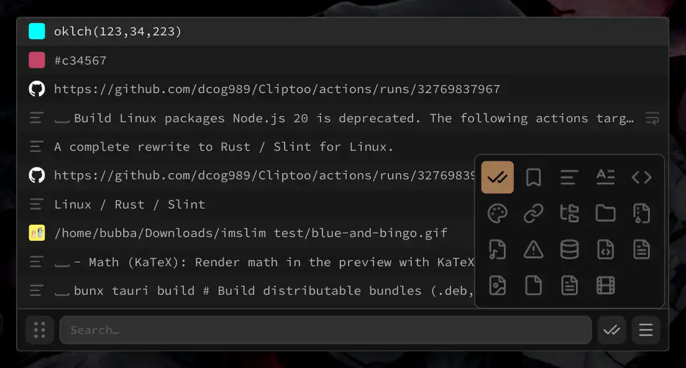

# Cliptoo

Advanced Linux clipboard manager. Use your clip history as a library of things. Rust, Slint, and SQLite = small footprint and fast performance.



---

## Features

### Performance

- **Persistent History:** SQLite FTS5 search with prefix matching.
- **Fast Search:** Real-time filtering with match highlighting.
- **Virtualized Scrolling:** only visible rows are rendered.
- **Deduplication:** SHA-256 hashing skips repeat copies.

### Clipboard & Paste

- **Capture:** text, rich text, HTML, images, and file paths.
- **Paste:** Enter pastes via an `evdev` virtual keyboard; optional plain-text mode.
- **Global Hotkey:** toggle the window via the XDG `GlobalShortcuts` portal (default `Ctrl+Alt+Q`).
- **Quick Paste:** hold Right Alt and press `1`–`9`.

### Content

- **Filters:** text, links, images, colors, bookmarks.
- **Images:** hover previews for PNG, JPEG, GIF, WebP, AVIF, JXL, SVG, ICO, BMP, and TIFF.
- **Colors:** `#hex`, `rgb()`, `hsl()`, `hwb()`, `lab()`/`lch()`, `oklab()`/`oklch()`/`okhsl()`, with transparency.
- **URLs and Files:** fetched titles and favicons; file size, mtime, and type.
- **Tags:** `##`-prefixed search.
- **Code:** monospace view toggle for code clips.

### Organization & Tools

- **Bookmarks:** exempt from auto-cleanup.
- **Reordering:** move clips up/down or to the top/bottom.
- **Transforms:** `upper`, `lower`, `camel`, `kebab`, `snake`, `trim`, `timestamp`, and more.
- **Send To / Compare:** open clips in an external app or a diff tool.

### Storage & Maintenance

- **Cleanup:** prune by age and/or count, clear caches, remove dead file clips, reclassify.
- **Backup:** JSON export/import, full history or bookmarks only.
- **Statistics:** DB size, clip count, copy/paste counts.

### Customisation

- Light/Dark/System theme, accent color, fonts, row padding, hover-preview delay and size.

### System Integration

- **Tray and autostart.**
- **App blacklist:** ignore selected applications.

## Tech Stack

| Component           | Technology                                       |
|---------------------|--------------------------------------------------|
| Language            | Rust (edition 2024)                              |
| UI Framework        | Slint (Qt 6 backend)                             |
| Wayland             | `wl-clipboard-rs`, `wayland-client`, wlr/ext data-control |
| Database            | SQLite + FTS5 (`rusqlite`)                       |
| Async Runtime       | Tokio                                            |
| Image Processing    | `image`, `resvg` (SVG), `jxl-oxide` (JXL)        |
| Colour Science      | `palette` (Oklab / Oklch / Okhsl)                |
| D-Bus / Portals     | `zbus`, `ashpd` (portal hotkeys)                 |
| System Tray         | Slint `SystemTrayIcon`                           |
| Input Emulation     | `evdev` virtual keyboard                         |
| HTTP Client         | `reqwest` (rustls)                               |

### LLM Use

Large Language Models (LLMs) were used to assist with code generation, refactoring, and documentation. All AI output was subject to human code review, automated testing, manual testing, and adversarial reviews.

---

## Installation

Cliptoo runs on **Wayland** only (KDE Plasma 6); X11 sessions are not supported. Keep `xdg-desktop-portal-kde` installed so global shortcuts work.

Prebuilt bundles are on the [releases page](https://github.com/dcog989/Cliptoo/releases).

### AppImage

```sh
chmod +x cliptoo-*-x86_64.AppImage
./cliptoo-*-x86_64.AppImage
```

Use [AppImageLauncher](https://github.com/TheAssassin/AppImageLauncher) or [GearLever](https://github.com/mijorus/gearlever) to add it to the menu.

### Packages

| Distro        | Install                                              |
|---------------|------------------------------------------------------|
| Debian/Ubuntu | `sudo apt install ./cliptoo_*_amd64.deb`             |
| Fedora/RHEL   | `sudo dnf install ./cliptoo-*.x86_64.rpm`            |
| Arch          | `sudo pacman -U cliptoo-*.pkg.tar.zst`               |

Local Arch build: `make package && sudo pacman -U .pkg/cliptoo-*.pkg.tar.zst`.

### From source

See [Prerequisites](#prerequisites). `make install` installs to `/usr/local`; `make uninstall` removes it.
Data lives in `~/.local/share/Cliptoo/` (DB, images), config in `~/.config/Cliptoo/`, cache in `~/.cache/Cliptoo/`, logs in `~/.local/state/Cliptoo/Logs/`.

---

## Development

### Prerequisites

- **Rust toolchain** (stable, edition 2024): `curl --proto '=https' --tlsv1.2 -sSf https://sh.rustup.rs | sh`
- **Qt 6, Wayland, dav1d, and fontconfig dev headers, plus the `clang` and `mold` linkers**
  (CI installs them and selects them with `CARGO_TARGET_*` env vars; for local
  builds put `linker = "clang"` and `rustflags = ["-C", "link-arg=-fuse-ld=mold"]`
  under `[target.x86_64-unknown-linux-gnu]` in `~/.cargo/config.toml`):

| Distro       | Command                                                                     |
|--------------|-----------------------------------------------------------------------------|
| Debian/Ubuntu| `sudo apt install qt6-base-dev qt6-wayland libwayland-dev libxkbcommon-dev libfontconfig1-dev libdav1d-dev pkg-config clang mold` |
| Fedora       | `sudo dnf install qt6-qtbase-devel qt6-qtwayland libwayland-devel libxkbcommon-devel fontconfig-devel dav1d-devel clang mold pkgconfig` |
| Arch         | `sudo pacman -S qt6-base qt6-wayland wayland wayland-protocols libxkbcommon fontconfig dav1d clang mold pkgconf` |

### Build & Run

```sh
git clone https://github.com/dcog989/cliptoo.git && cd cliptoo
```

```sh
cargo install cargo-edit cargo-outdated cargo-sweep   # optional

cargo run                              # debug build and run
cargo test --workspace
cargo clippy --workspace --all-targets -- -D warnings
cargo fmt --all -- --check
cargo fmt --all                        # apply formatting
slint-lsp format -i src/ui/ui/*.slint
make translations                      # rebuild PO catalogs from @tr()

cargo outdated -w
cargo upgrade && cargo update --verbose
cargo sweep --time 14
cargo clean
```

### Release

Releases use [Cocogitto](https://cocogitto.io/) (`cargo install cocogitto` / `sudo pacman -S cocogitto`), configured in `cog.toml`.

```sh
cog bump --auto               # bump version, sync manifests, write `CHANGELOG.md`, commit, tag, push
cog bump --version 1.23.4     # manual version
cog changelog                 # changelog preview
```

Commits must use [Conventional Commits](https://www.conventionalcommits.org/) — enforced on commit via `cog verify`.

---

## License

[GNU General Public License v3.0](LICENSE).
